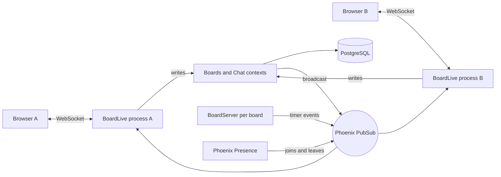

# Huddle

A real-time collaborative board built with **Elixir** and **Phoenix LiveView**.
Open a board in two browser windows and every card, cursor, chat message and
timer tick shows up in both at once. There is no sign-up: share the link and
people can join.

## Features

- **Live board**: add, vote on, delete and drag cards between columns. Every
  change is pushed to everyone on the board.
- **Presence**: see who is online right now.
- **Live cursors**: watch other people's pointers move across the board.
- **Chat and activity feed**: messages with typing indicators, plus automatic
  notes such as "Ada moved 'Write tests' to Done".
- **Shared timer**: anyone can start a countdown that runs for the whole board.
- **Guest identities**: each new visitor starts as Kshitij Dua with a random colour, stored in a
  signed session cookie, and can rename themselves.
- **Light and dark themes.**
- **Sharing:** a Share button with copyable edit and view-only links and QR codes.
  View-only access is enforced on the server.
- **Recent boards:** the home page remembers boards opened by your guest identity.
- **Board tools:** edit card text, choose coloured labels, manage columns, react
  to cards and messages, and search or filter cards by label.
- **Meeting tools:** hide and reveal vote counts, present with shared scrolling
  and card spotlights, and export a board as Markdown or CSV.
- **Animated interface:** responsive layouts, hover transitions, and timer
  celebration effects with reduced-motion support.

## Sharing a board

Open a board and select **Share**. Choose **Can edit** or **View only**, then
copy the link or scan its QR code. Anyone with an edit link can change the board;
give viewers the separate view-only link.

The app currently runs at `http://localhost:4000`. A localhost link only works
on this Mac. Sharing with other computers requires a deployed app, a tunnel,
or a development server configured to accept connections on your local network.
The Share dialog uses the address you opened, so links and QR codes use that host.

## How it works



Each browser tab is backed by its own LiveView process on the server. Those
processes never talk to each other directly. They subscribe to the board's
PubSub topic, and the contexts broadcast after every successful write.

| Concept | Where to look | What it does here |
| --- | --- | --- |
| LiveView | `lib/huddle_web/live/board_live.ex` | Renders the board and handles every user action over one WebSocket |
| PubSub | `lib/huddle/boards.ex`, `lib/huddle/chat.ex` | Tells every subscriber when a board changes or a message arrives |
| Presence | `lib/huddle_web/presence.ex` | Tracks who is on each board |
| GenServer | `lib/huddle/board_server.ex` | One process per active board holding the shared timer |
| DynamicSupervisor and Registry | `lib/huddle/application.ex` | Start board processes on demand and find them by board id |
| Ecto | `lib/huddle/boards/`, `priv/repo/migrations/` | Schemas, validations, and card ordering inside a transaction |
| JS hooks | `assets/js/hooks.js` | Drag and drop, cursors, chat scrolling and the countdown display |

A few decisions worth knowing about:

- **Cursor positions and typing signals skip the database.** They are relayed
  through PubSub and forgotten, because they are only useful for a moment.
- **The timer sends one message, not one per second.** The server broadcasts
  the time the timer ends and each browser counts down by itself.
- **Votes are incremented in SQL** (`UPDATE ... SET votes = votes + 1`), so two
  people voting at the same instant never overwrite each other.
- **A crashed board process only affects its own board.** Each `BoardServer`
  is supervised separately and stops itself after ten idle minutes.

## Running it locally

You need Elixir 1.17 or newer and PostgreSQL.

```bash
# macOS with Homebrew, if you don't have PostgreSQL yet
brew install postgresql@17
brew services start postgresql@17

mix setup        # install dependencies, create and seed the database
mix phx.server   # then open http://localhost:4000
```

The database user defaults to your system user name (which is what Homebrew
sets up). Set `PGUSER` and `PGPASSWORD` if yours is different.

To see the real-time part, open the same board in two windows side by side.

## Tests

```bash
mix test
```

The suite covers the contexts (card ordering, validations, broadcasts), the
`BoardServer` process, and the LiveViews, including tests that connect two
browsers to one board and check that a change in one appears in the other.

## Project layout

```
lib/huddle/            business logic: boards, chat, identities, BoardServer
lib/huddle_web/        LiveViews, layout, router, presence, session handling
assets/js/hooks.js     client-side hooks
priv/repo/             migrations and seed data
test/                  ExUnit tests
```
